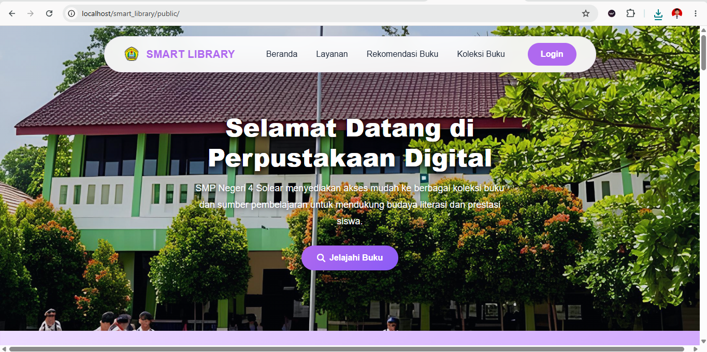
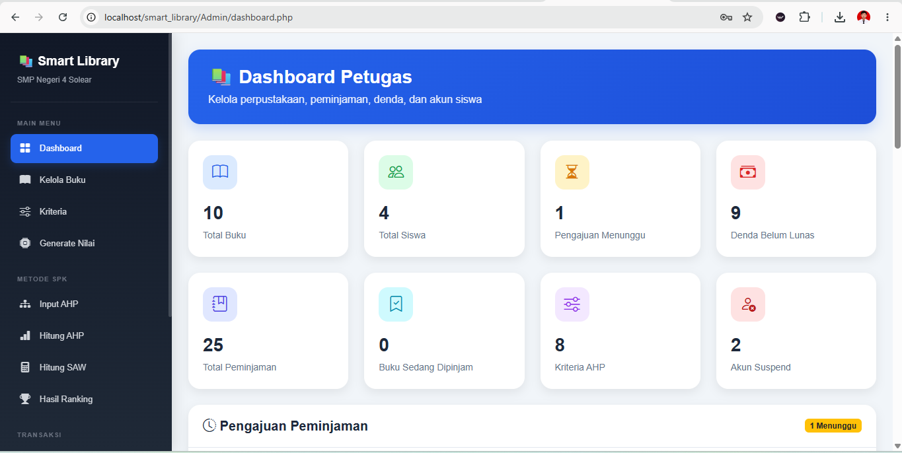
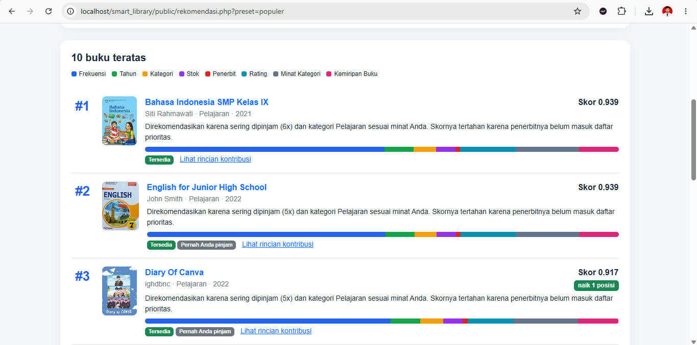

# 📚 Smart Library — Sistem Rekomendasi Buku & Manajemen Perpustakaan (SPK AHP & SAW)

[](https://php.net)
[](https://mariadb.org)
[](#-metode-spk-ahp--saw)

**Smart Library** adalah aplikasi manajemen perpustakaan berbasis web yang dilengkapi dengan **Sistem Pendukung Keputusan (SPK)**. Platform ini dirancang untuk mempermudah sirkulasi peminjaman buku serta memberikan rekomendasi buku secara presisi bagi pengguna dengan mengombinasikan metode **Analytic Hierarchy Process (AHP)** (untuk bobot kriteria konsisten) dan **Simple Additive Weighting (SAW)** (untuk perangkingan alternatif).

---

## 📸 Tampilan Aplikasi

| Halaman Utama Katalog | Dashboard Admin & SPK |
|---|---|
|  |  |

| Hasil Rekomendasi Home| Rekomendasi Hasil perhitungan Dashboard |
|---|---|
|  | 

---

## ✨ Fitur Utama

- **Publik / Anggota**:
  - Katalog buku interaktif dan fitur pencarian cepat.
  - Rekomendasi buku terpersonalisasi berdasarkan kalkulasi SPK.
  - Pengajuan peminjaman, pemantauan riwayat, dan fitur pengembalian.
  - Penilaian/rating buku serta notifikasi sistem.
- **Admin**:
  - Manajemen data buku (Tambah, Edit, Hapus, Export/Import Data).
  - Manajemen transaksi peminjaman & pengajuan anggota.
  - **Modul SPK AHP (`Admin/ahp/`)**: Input perbandingan berpasangan, kalkulasi matriks eigen, dan pengujian konsistensi ($CR \le 0.1$).
  - **Modul SPK SAW (`Admin/saw/`)**: Penilaian matriks keputusan, normalisasi (*Benefit/Cost*), dan pemeringkatan nilai komposit.
  - Laporan analitik pencarian dan audit log aktivitas sistem.

---

## 📐 Metode SPK (AHP & SAW)

1. **Analytic Hierarchy Process (AHP):**
   Digunakan untuk menentukan bobot prioritas kriteria ($W_i$) dengan jaminan konsistensi matematis:
   $$CI = \frac{\lambda_{max} - n}{n - 1}$$
   $$CR = \frac{CI}{RI} \le 0.1$$

2. **Simple Additive Weighting (SAW):**
   Digunakan untuk merangking seluruh alternatif buku berdasarkan bobot kriteria AHP:
   - Kriteria Benefit: $R_{ij} = \frac{X_{ij}}{\max(X_{ij})}$
   - Kriteria Cost: $R_{ij} = \frac{\min(X_{ij})}{X_{ij}}$
   - Skor Akhir: $V_i = \sum_{j=1}^{n} W_j \cdot R_{ij}$

---

## 🛠️ Teknologi yang Digunakan

- **Backend**: PHP 8.x
- **Database**: MySQL / MariaDB
- **Frontend**: HTML5, CSS3, JavaScript, Bootstrap
- **Web Server**: Apache (XAMPP / Laragon)
- **Version Control**: Git & GitHub

---

## ⚙️ Cara Instalasi & Pengaturan Lokal

1. **Clone Repositori**
   ```bash
   git clone https://github.com/Alam0000/smart-library.git
   cd smart-library
   ```

2. **Pindahkan ke Direktori Web Server**
   - **XAMPP**: `C:/xampp/htdocs/smart_library`
   - **Laragon**: `C:/laragon/www/smart_library`

3. **Impor Database**
   - Buka **phpMyAdmin** (`http://localhost/phpmyadmin`).
   - Buat database baru bernama `smart_library`.
   - Impor berkas `.sql` yang terdapat di folder `database/` (`migrasi_fitur_lanjutan.sql` & `migrasi_kriteria_cost.sql`).

4. **Konfigurasi Database**
   Sesuaikan kredensial koneksi di file `connection/koneksi.php`:
   ```php
   $host = "localhost";
   $user = "root";
   $pass = "";
   $db   = "smart_library";
   ```

5. **Akses Aplikasi**
   - **Portal Publik/Anggota**: `http://localhost/smart_library/public/`
   - **Dashboard Admin**: `http://localhost/smart_library/Admin/`

---

## 📜 Lisensi & Hak Cipta

Pengembangan Sistem **Smart Library** (SPK AHP & SAW) — Hak Cipta © 2026 **Tajul Alamsyah**.
